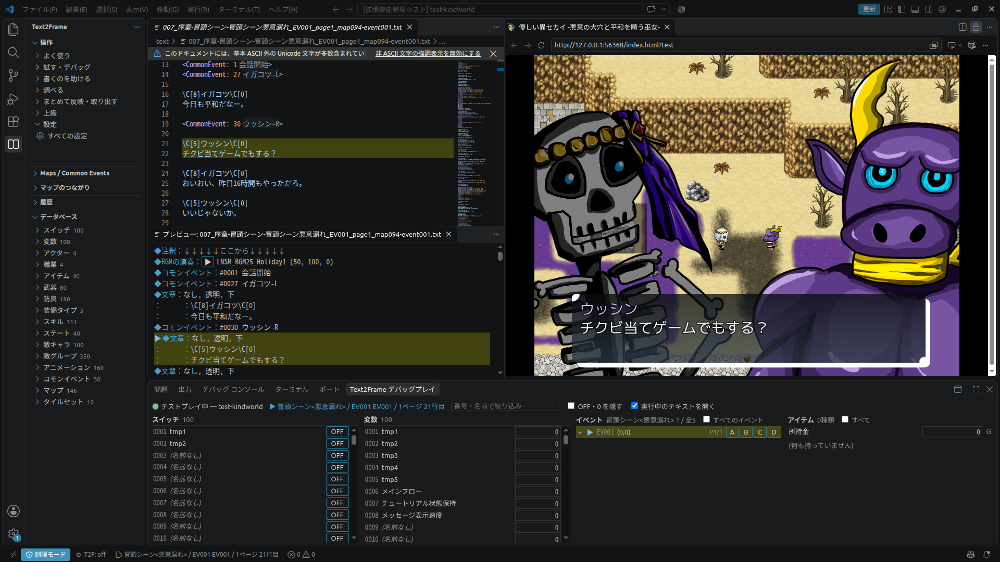
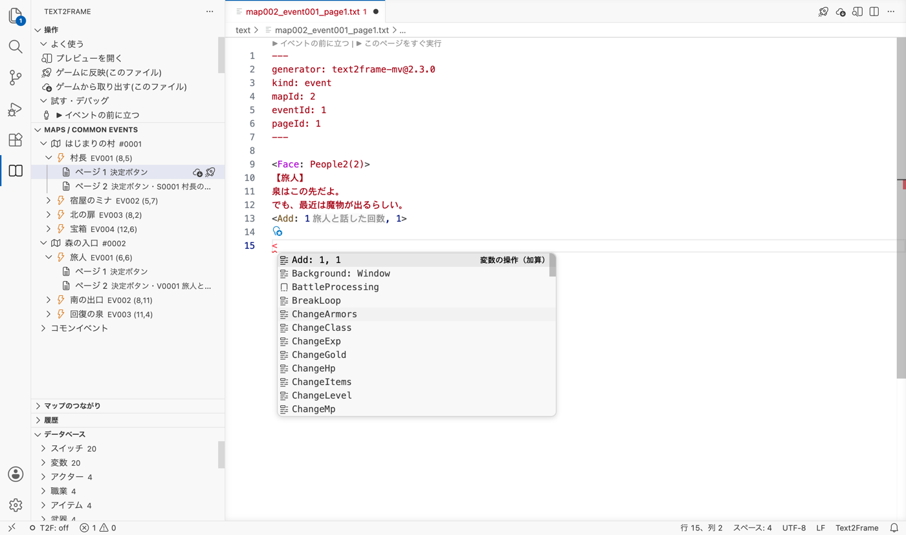
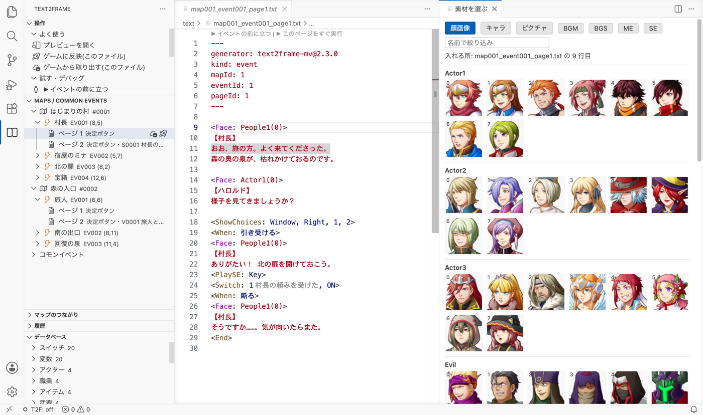

# Text2Frame Language Support
**RPG ツクール MV / MZ のイベントを、VS Code でテキストとして書き、デバッグするための拡張機能です。**
この機能を使うことにより、本来は RPG ツクール MV / MZ エディタ上でしか編集できないゲームのイベントを、テキストで編集することが可能になります。
また、テキストを書くためのサポート機能も充実しており、テストプレイも VS Code 内で実行することができるため、新たなゲーム制作エディタとして機能します。

イベントをテキストで編集するための記法やツクールへの取り込みといった基本機能は、ツクール MV / MZ 版プラグイン Text2Frame に準拠します。
詳しくは GitHub リポジトリの [README](https://github.com/yktsr/Text2Frame-MV) や、[Wiki](https://github.com/yktsr/Text2Frame-MV) をご参照ください。
元々は、台本をツクールにコピー＆ペーストすること（ツクールの仕様上非常に面倒な作業）を助けるためのツールだったため、最初に実装されたメッセージ系のイベントコマンドの記法は簡単です。
それ以外のイベントコマンドについても、タグで1対1に対応しているといった、シンプルな記法で実現されています。

基本機能は以下の通りです。

- ツクール版 Text2Frame / Frame2Text の全機能（テキストのイベント取り込みや取り出し、自動同期等）
- リッチなシンタックスハイライトやタグの解説
- ツクール側のデータベース・スイッチ/変数・ピクチャ・BGMといった情報の参照＆書き込み機能
- VS Code 内でのテストプレイ機能（※ ただしセーブデータは共有されません）
- ツクールにはないリッチなイベントのデバッグ機能

なお、以下の説明は、ある程度 ツクール版 Text2Frame の使い方を知っている方向けに書かれています。

## 使い方
最初に、VS Code のメニュー「ファイル」→「フォルダーを開く」で、ツクールのゲームのフォルダ（中に `data` フォルダがある所）を開きます。

次に、左端の **Text2Frame のアイコン**（本のマーク）を押すと、このプラグインによる機能にアクセスすることができます。

## おすすめの始め方
すでにツクール版や CLI 版の Text2Frame を使っている場合はそのままお使いいただけますが、ここで初めて使う場合は、まずゲーム内のイベントをテキストに変換して始めることをおすすめします。

最初に、テキスト化するゲーム内のイベントの条件を設定します。
左のメニューの「操作」→「設定」→「すべての設定」の `Text2Frame:Export Scope` か、以下のいずれかを設定することが可能です。最初は 1. か 2. がおすすめです。

1. `中身のあるものだけ`: コマンドが一つもないページ・コモンイベントは作らない（既定）
2. `会話があるものだけ`: 文章・選択肢・スクロールのテキストが含まれるものだけ
3. `見出し情報付きテキストだけ`: 新しくは作らず、見出し情報付きテキストだけを更新する
4. `全部`: 空のページも含めて全部作る。

次に、左端の Text2Frame のアイコン（本のマーク）を押した後に出るメニューから、「操作」→「まとめて反映・取り出す」→「すべてゲームから取り出す」で、先に設定した対象のイベントをテキスト化したものが、`text` フォルダに保存されます。`text` フォルダがない場合は、自動で作成されます。

対応するイベントは、ファイル名にあるマップ名・イベント名・ページ番号や、テキスト内の見出し情報からも確認できます。

## Text2Frame の基本機能
Text2Frame の基本機能として、テキストをゲームに反映する機能や、逆にテキストに取り出す機能を紹介します。

### 自動反映
左のメニューから「よく使う」にある「保存時に自動反映」を確認し、`オン`になっていれば、テキストを編集するとその対応するイベントがツクール内のイベントに反映されます。（「保存時に自動反映」をクリックすることで、`オン`と`オフ`を切り替えられます。）
また、ツクール側で編集して保存することでも、テキストに自動反映されます。
つまり、双方向に編集内容が自動で同期されるということです。

### ゲームに反映（このファイル）
双方向の自動反映を使用しない場合、左のメニューの「よく使う」にある「ゲームに反映（このファイル）」をクリックすることで、テキストの内容をツクールに反映することができます。
反映時のモードは、「操作」→「設定」→「すべての設定」の `Text2Frame:Strategy` から変更可能です。

**注意**
テキストを編集して保存した際は、ツクールのエディタから保存する前に開き直してください。
ツクールから保存すると、反映した内容がツクール側の古い内容で上書きされます。

### ゲームから取り出す（このファイル）
ツクールの内容をテキストに反映する際は、「ゲームから取り出す（このファイル）」を使用することで、ツクール側のイベントの情報をテキストに反映可能です。
この反映時のモードも、「操作」→「設定」→「すべての設定」から変更可能です。

## 便利機能
VS Code 上からオリジナルの Text2Frame の機能を呼び出したり、Text2Frame 用シンタックスハイライトがあるだけでも結構便利ですが、その他にも便利機能があるのでいくつか使い方を紹介します。

### プレビュー機能

イベントに対応するテキストを開いた状態で、画面右上のプレビューアイコン（画面分割に虫眼鏡の描かれたアイコン）をクリックすることでプレビュー画面を開けます。
プレビュー画面では、ツクール上のエディタのような表記で、内容を確認することができるようになります。

### テストプレイ機能
以下のいずれかの方法で、テストプレイを実行できます。ただし注意点として、**ツクールのテストプレイとのセーブデータは共有されません。**

- テキストファイル上部の「テストプレイ」をクリック
- Text2Frame のメニューの「よく使う」の中にある「テストプレイ」をクリック

以上のテストプレイは、ツクールの、タイトル画面から入る通常のテストプレイと同様の仕様です。

テキストの上部や、Text2Frame のメニューの「よく使う」の中にある「このページをすぐ実行」をクリックすることで、即座に編集中のテキストファイルのイベントを実行可能です。

### テキスト編集支援機能

Text2Frame の記法やツクールに特化した、テキスト編集の専用支援機能がたくさんあります。
以下の表に、それらの一覧を示します。

| 機能 | 説明 |
| --- | --- |
| タグの候補 | `<` を打つと、タグの候補が説明つきで出ます |
| タグの説明 | タグにマウスを合わせると、意味と使用例が出ます |
| データベースの名前 | `<Switch: 1, ON>` の `1` の横に、スイッチ1の名前が薄く出ます（ファイルには書き込みません）。マウスを合わせると詳しく出て、データベースに無い番号には印が付きます |
| 名前から番号を入れる | 番号を書く所で候補を出すと、名前で探して番号を入れられます |
| 書き間違いの指摘 | `< >` の閉じ忘れ、空のタグ、タグとして読まれずにゲームにそのまま文字で出てしまう行に、波線が付きます |
| メッセージのはみ出し | ウィンドウの幅を超える行に波線が付きます（顔グラフィックがあるときは、そのぶん狭く数えます）。自動で改行するプラグインが有効なプロジェクトでは調べません |
| 色見本 | 画面の色調変更・フラッシュなど、色を指定するタグの横に色見本が出ます |

### 画像・音の関連タグの入力支援

右クリックから専用のメニューを押すことで、画像のタグや音関連のタグを VS Code 上から GUI で作成可能です。

入れたい行にカーソルを置き、エディタで右クリック →「Text2Frame: 画像を選ぶ(顔・キャラ・ピクチャ)」または「Text2Frame: 音を選ぶ」を押すと、「**素材を選ぶ**」のタブが開きます。

- 上のタブで「顔画像」「キャラ」「ピクチャ」「BGM」「BGS」「ME」「SE」を切り替えます。「名前で絞り込み」で探せます。
- 音は ▶ で試し聞きでき、「入れる」で `<PlayBGM: 名前, 90, 100, 0>` などが入ります。
- `<Face:` `<ChangeImage:` `<ShowPicture:` の候補のいちばん上の「一覧から見て選ぶ…」や、そのタグの行の電球からも開けます。

### データベースの値の入力
タグでよく使用するデータベース・スイッチ・変数の ID や名前等を VS Code 上から参照し、以下の手順でテキストに入力できます。

- 画面左のメニューから「データベース」でスイッチ・変数・アクター等の一覧を開き、所望の項目をクリックする。

### スニペット
よく使うタグやテキストをスニペットとして登録し、いつでも簡単に呼び出すことが可能です。

スニペットの登録は以下のいずれかの方法で実行できます。いずれも、作成したいタグ・テキストを範囲選択した状態で実行します。

- 右クリック → 「Text2Frame: 選んだ部分をスニペットにする」をクリック
- 左のメニューの「操作」→「書くのを助ける」→「選んだ部分をスニペットにする」をクリック

スニペットの呼び出しは、以下のいずれかの方法です。

- 行頭で`/`を入力すると、登録されたスニペット一覧が出るため、選択する（名前を入力することで候補を絞れます）
- 左のメニューの「操作」→「書くのを助ける」→「スニペットを入れる」からも一覧が出るため選択する

### テキスト間移動
以下の操作で、テキスト間の移動を楽に行えます。

| 名前 | 操作 | できること |
|--- | --- | --- |
| 定義へ移動| `F12`、`Ctrl`/`Cmd` を押しながらクリック| `<CommonEvent: 1>` からそのコモンイベントのテキストへ、`<JumpToLabel: …>` からそのラベルへ、スイッチ・変数の番号から値を変えている所へ、場所移動のマップ番号からそのマップのテキストへ |
| 参照の一覧|`Shift+F12` | そのスイッチ・変数・コモンイベントなどを使っている所を、プロジェクト全体から一覧にします |
| 名前で開く|`Ctrl+T` / `Cmd+T` | マップ名・イベント名・コモンイベント名の一部を打って、そのテキストを開きます |
| アウトライン・折りたたみ | クリック |選択肢・条件分岐・ラベル・メッセージが入れ子で並び、畳めます |

### プロジェクト全体を検査する
「操作」→「調べる」→「プロジェクト全体を検査」で、全部のテキストを調べて、見つかった問題を VS Code の「問題」パネルに表示します。

- 書き間違い（閉じ忘れ・空のタグ・タグとして読まれない行・コンパイルできない所）
- データベースに無い番号、無い顔画像、無い音声
- 残っている衝突の目印、メッセージのはみ出し
- 宛先のメモが指す場所がゲームに無いもの、ゲームに反映していない変更があるもの

### その他機能
上述した機能の他にも、以下のような機能があります。

- デバッグ機能: テストプレイ中にスイッチや変数を操作できます。
- 履歴機能: 反映や取り込みの履歴を管理し、任意の状態に戻すことが可能です。
- マップのつながり: 左のメニューから、場所移動でつながったマップを表示できます。

## 設定
この拡張機能全体の設定は以下のいずれかの方法で開くことができます。

- VS Code の設定（`Ctrl+,` / `Cmd+,`）で `text2frame` と検索する
- 左のメニューから「操作」→「設定」→「すべての設定」をクリックする

## 困ったとき
| こんなとき | どうする |
| --- | --- |
| 反映したのに、ツクールで見ると変わっていない | ツクールを保存せずに閉じて、開き直してください |
| 反映を押しても書き込まれない | 差分の画面が開いています。右上の ✓ か、知らせの「反映する」を押してください |
| 画面の左下が `T2F fail` になる | 書き方の間違いです。`T2F fail` を押すと理由が出ます |
| テキストに衝突の目印が入っている | 両方で同じ所を変えた印です。残したい方だけにして衝突の目印を消し、もう一度反映してください |
| 取り出したら、書いた文が消えた | 「上級」の「全部取り直す(上書き)」は、統合（merge）ではなく上書き（overwrite）で、テキストを全部置き換えます。ふだんは「ゲームから取り出す」を使ってください。履歴から戻せます |
| `.txt` に色が付かない | 先頭に宛先のメモ（`---` で囲んだ部分）があるファイルだけが対象です |
| 「ツクールのプロジェクト(data/System.json)が見つかりません」と出る | ゲームのフォルダ（`data` がある所）を開いてから、もう一度試してください |
| テストプレイが真っ黒・エラーになる | 設定 `text2frame.testPlayPage` に、ゲームのフォルダで最初に開くページを入れてみてください |
| テストプレイが止まったまま進まない | 「印をつけた行で一時停止する」がオンで、印の行に来たのかもしれません。知らせの「続ける」を押すか、「操作」→「上級」でオフにしてください |
| 画面の言葉が英語で出る | 下の「[表示の言語](#表示の言語)」を見てください |

## 表示の言語
画面の言葉は、VS Code の表示言語に合わせて日本語か英語で出ます。
日本語で出ないときは、拡張機能の画面で **Japanese Language Pack** を入れ、コマンドパレットの「Configure Display Language」で `ja` を選んで、VS Code を再起動してください。
タグの説明と、Text2Frame 本体が出す警告は、表示言語に関係なく日本語です。

## 動かすのに必要なもの
- VS Code 1.85.0 以上（Windows / Mac）
- RPG ツクール MV / MZ のプロジェクト

## ライセンス・リンク
- ライセンス: MIT
- [Text2Frame-MV（GitHub）](https://github.com/yktsr/Text2Frame-MV) — 不具合の報告や要望は [Issues](https://github.com/yktsr/Text2Frame-MV/issues) へ
